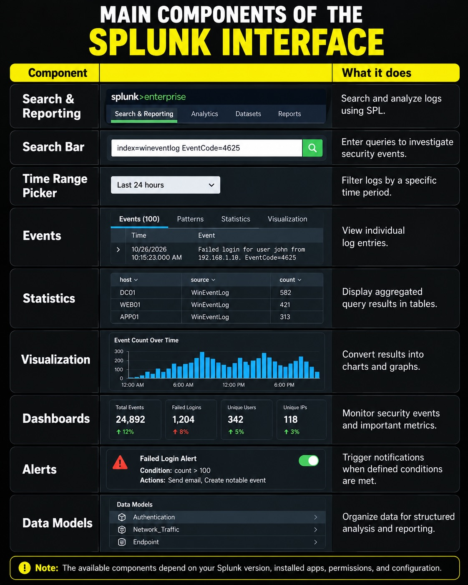
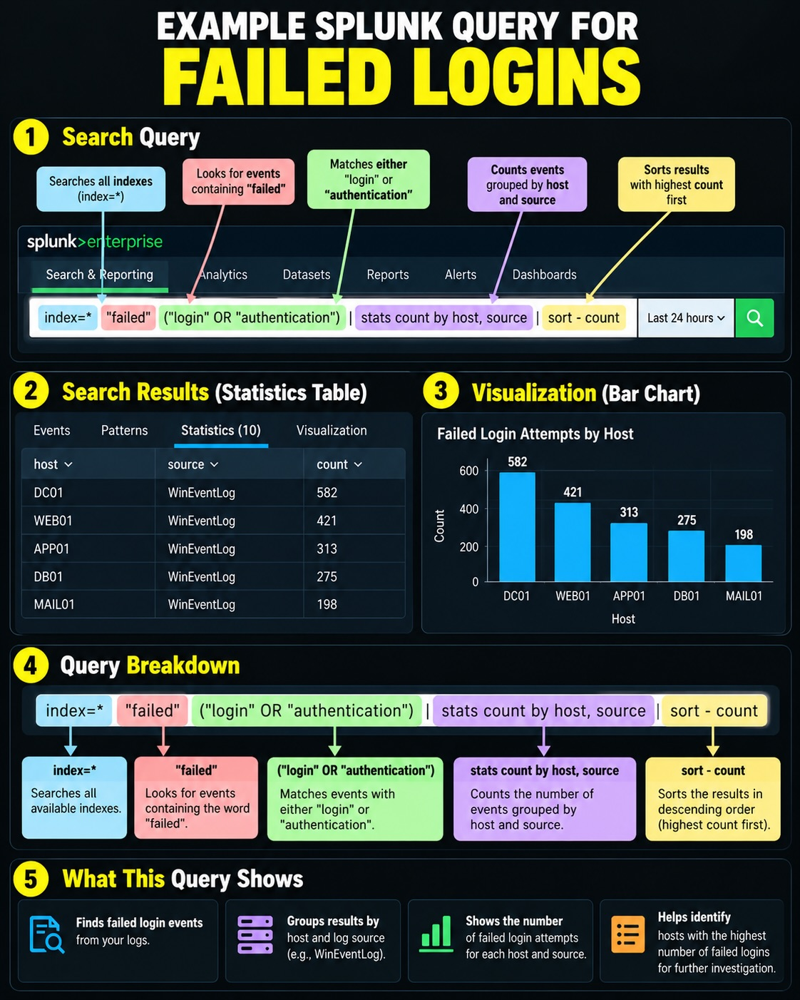
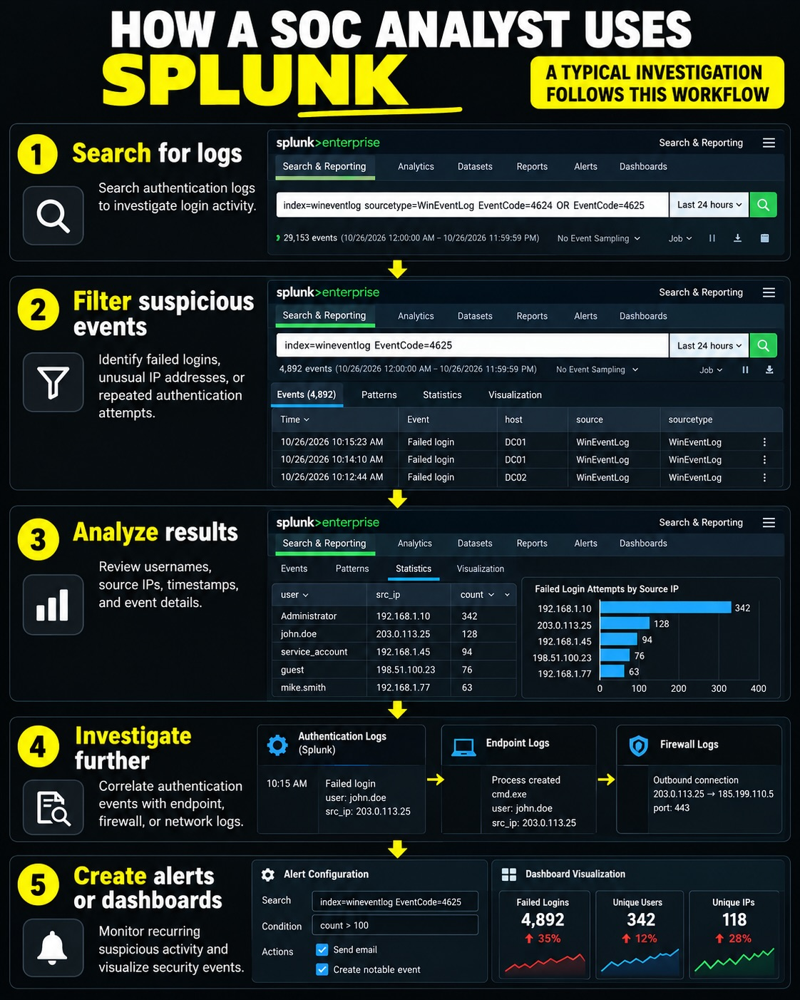

# Splunk SOC Lab Project

## 📊 Splunk Interface Overview

Understand the key Splunk Search & Reporting components used during security investigations.

## 🔎 Failed Login Detection with SPL

Example query breakdown for identifying and grouping failed-login events.

## 🖥️ SOC Analyst Interface

Illustrative overview of search, event fields, and visualization panels.

## Use Cases
- Failed Login Detection (4625)
- Successful Login Monitoring (4624)
- User Creation Detection (4720)
- Privilege Escalation Monitoring (4672)

## Dashboards
- SOC Monitoring Dashboard
- Failed Login Dashboard

## Alerts
- Brute Force Login Detection
- User Creation Alert

## Skills
Splunk, SIEM, Log Analysis, Windows Event Monitoring, SOC Operations
